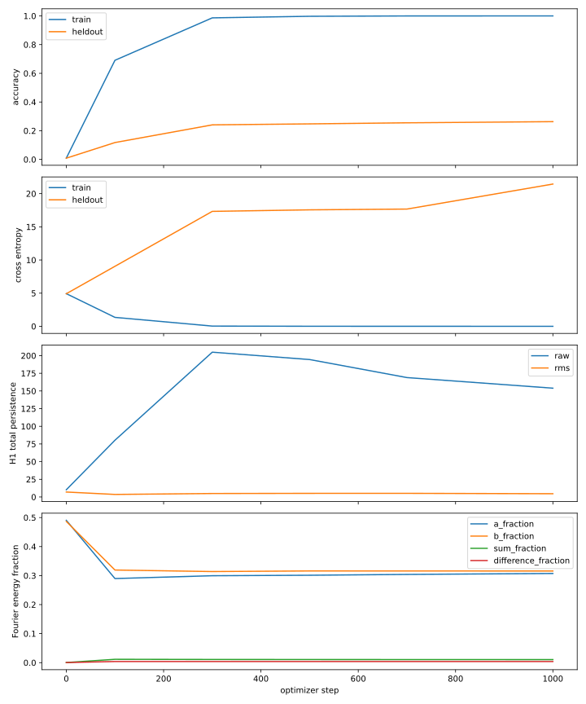

# Topology of Grokking

Can we track how a transformer’s internal representations change as it moves from memorizing examples to generalizing? This research project trains small transformers on modular arithmetic, then analyzes hidden activations across checkpoints with persistent homology, Fourier analysis, and targeted interventions.

## What the experiments showed

In the 1,000-update modular-addition pilot with modulus 113, training accuracy reached **100%** while held-out accuracy reached **26.33%**. The pilot recorded changes in normalized H1 persistence during memorization. It did not observe sustained delayed generalization within that run.

An exploratory intervention at the same checkpoint removed activation components at two sum-related Fourier frequencies. Held-out accuracy fell from **26.33% to 25.14%**. The normalized H1 Wasserstein shift was close to the shifts from three matched random controls. This establishes a measured effect under the intervention, with the relationship between topology and delayed generalization still open.

[Read the pilot report, including settings, controls, and limitations.](https://github.com/MikeMaxwell77/Topology_of_Grokking/blob/ca1e9861c1f7d597c22beea33901001170d511c8/research/PILOT_REPORT.md)



## Reproduce the pilot

Use the revision that produced the tracked report and plots. Commands are shown for Bash.

```bash
git clone https://github.com/MikeMaxwell77/Topology_of_Grokking.git
cd Topology_of_Grokking
git switch --detach ca1e9861c1f7d597c22beea33901001170d511c8
python -m pip install -r requirements.txt
python -m unittest discover -s tests -v
python -m grokking.circuits --output outputs/circuit_pilot --p 113 --steps 1000 \
  --log-every 50 --save-every 100 --initialization pytorch
python -m grokking.circuit_analysis outputs/circuit_pilot \
  --output outputs/circuit_pilot/analysis_fixed --steps 0,100,300,500,700,1000 \
  --candidate-frequencies 31,42 --threads 1
```

The [controlled topology study](https://github.com/MikeMaxwell77/Topology_of_Grokking/blob/33d1a5d776c01a9da6338f8b01ebb3c169599846/research/TOPOLOGY_STUDY.md) defines a separate 40,000-update baseline with a fixed train/held-out split and offline topology analysis. Completing and classifying that baseline is the next research milestone.
